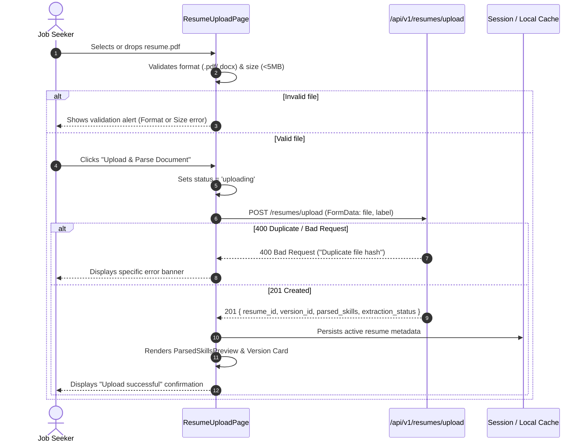

# SwipeX Milestone 3 — AI Resume Analysis & Recommendations
## Frontend & User Experience Architecture & Implementation Plan
**Author**: Intern 1 — Frontend & User Experience (Domain-4)  
**Target Milestone**: Milestone 3 (Weeks 5 & 6)  
**Deliverable Type**: Day 1 Architecture Review, Technical Blueprint & Wireframe Specifications  
**Date**: September 23, 2026  
**Status**: APPROVED FOR DAY 2 IMPLEMENTATION  

---

## Executive Summary

Milestone 3 marks the evolution of SwipeX from a heuristic swipe discovery prototype (Milestone 2) into an **intelligent, AI-powered career co-pilot**. In Milestone 3, Job Seekers gain the ability to upload multi-version resumes (PDF/DOCX), inspect parsed capabilities, benchmark their readiness against live job requisitions with a blended ATS compatibility score (keyword overlap + semantic similarity), receive prioritized AI/rule-based optimization suggestions, and discover opportunities ranked by semantic affinity with clear AI match percentage badges.

As **Intern 1 (Frontend & User Experience)**, our scope strictly encompasses `Team-3/Domain-4/`. In adherence with team boundaries:
- We build strictly **on top of** the validated Milestone 2 frontend architecture.
- We do **not** rebuild existing M2 pages or modify other domains (`Domain-1`, `Domain-2`, `Domain-3`, `Domain-5`).
- We use 100% free and open-source frontend tooling (React 18, Vite 6, Tailwind CSS 3, Lucide React).
- Day 1 is dedicated to thorough architectural analysis, cross-domain contract verification, component hierarchy planning, responsive UX wireframing, and risk mitigation.

---

## 1. Current M2 Frontend Architecture Summary

The existing frontend codebase located in `Team-3/Domain-4/` is a modern, modular Single Page Application (SPA) structured as follows:

```
Team-3/Domain-4/src/
├── App.jsx                     # Root application routing, Auth & RBAC guards
├── index.css                   # Tailwind directives, custom surface utilities, animations
├── main.jsx                    # React 18 DOM mount entrypoint
├── assets/                     # Static graphics and icons
├── components/
│   ├── FilterBar.jsx           # Multi-criteria job discovery filter bar
│   ├── JobCard.jsx             # Interactive Tinder-style swipeable card with gesture physics
│   ├── Navbar.jsx              # Public landing page navigation header
│   ├── common/
│   │   ├── Button.jsx          # Reusable button (variants: filled, tonal, outlined, text)
│   │   ├── Chip.jsx            # Reusable pill badge (interactive and static)
│   │   └── Input.jsx           # Reusable form field with icon, helper text & error support
│   └── dashboard/
│       ├── AdminDashboard.jsx  # Admin portal metric graphs & management panels
│       ├── JobSeekerDashboard.jsx # Legacy monolithic Job Seeker dashboard
│       └── RecruiterDashboard.jsx # Recruiter candidate pipeline & posting panels
├── data/
│   └── mockJobs.js             # Seed job postings fallback catalog
├── layouts/
│   ├── AppLayout.jsx           # Public marketing & authentication page shell
│   └── RoleDashboardShell.jsx  # Authenticated sidebar shell with strict RBAC navigation
├── pages/
│   ├── CompanyDetailPage.jsx   # Organization culture, tech stack & active openings
│   ├── CompanyListPage.jsx     # Company directory & startup showcase
│   ├── DashboardPage.jsx       # Gateway dispatcher redirecting by session role
│   ├── HomePage.jsx            # Product showcase landing page
│   ├── LoginPage.jsx           # JWT authentication form
│   ├── ProfilePage.jsx         # Candidate profile editing
│   ├── RegisterPage.jsx        # Role-based onboarding form
│   ├── ResumeUploadPage.jsx    # M2 single-file resume upload prototype
│   ├── SwipeDiscoveryPage.jsx  # Gesture-driven job deck with undo & filters
│   └── dashboard/
│       ├── admin/              # Dedicated admin tab sub-pages
│       ├── jobseeker/          # Dedicated Job Seeker workspace sub-pages
│       └── recruiter/          # Dedicated Recruiter workspace sub-pages
└── services/
    ├── api.js                  # Central fetch wrapper (JWT bearer injection, error parser)
    ├── auth.js                 # Authentication session state, tokens & reactive observer
    ├── companies.js            # Organization catalog API client
    ├── jobs.js                 # Job queries, search & swipe telemetry API client
    ├── recommendations.js      # Job recommendations API client (M2 heuristic)
    └── resume.js               # Resume upload & ATS score client (M2 stub)
```

### Core Architecture Characteristics:
1. **Tooling & Build System**: Powered by **Vite 6** and **React 18.3**. Code is transpiled via `@vitejs/plugin-react` and bundled with ESM standards.
2. **Design Language & Styling**: Styled using **Tailwind CSS 3.4** utilizing custom design tokens defined in `tailwind.config.js`:
   - Surface colors: `#131316` (default), `#1c1c20` (container), `#242429` (elevated), `#2c2d33` (high).
   - Brand accent: Google Pixel / Material-inspired calm violet/purple `#9d7bf6` (`primary`) with container `#312154` and contrast text `#e9ddff`.
   - Content typography: Neutral slate shades `#e3e3e7` (default), `#9697a0` (muted), `#6d6e77` (subtle) using Google Fonts `Inter` / `Roboto`.
3. **Routing & Navigation Hierarchy**: Managed via **React Router DOM v7**. Routes are organized into:
   - **Public Routes** (`/`, `/login`, `/register`).
   - **Guarded Role Workspaces** wrapped in `RoleDashboardShell`:
     - Job Seeker: `/dashboard/job-seeker/*`
     - Recruiter: `/dashboard/recruiter/*`
     - Administrator: `/dashboard/admin/*`
4. **Authentication & RBAC**:
   - `authService` stores tokens in `localStorage` under `swipex_auth_session`.
   - `ProtectedRoute` ensures only authenticated sessions access dashboards.
   - `RoleRoute` strictly prevents role crossover (e.g. Recruiters or Admins attempting to access Job Seeker ATS features are redirected to their respective dashboards).
   - Outgoing HTTP calls via `api.js` automatically inject `Authorization: Bearer <access_token>` and `X-User-Id`.
5. **Swipe Deck & Gesture Physics**:
   - `SwipeDiscoveryPage.jsx` implements dual feed modes: `recommended` (personalized) and `all` (broad search).
   - `JobCard.jsx` handles pointer capture, horizontal drag displacement, rotation angles (`deg = dragX * 0.07`), stamp opacity transitions (Green "APPLY" stamp on right pull, Red "PASS" stamp on left pull), and a stack preview for the background card.
   - Includes full undo capability via local history stack and remote swipe dispatch.

---

## 2. Reusable Existing Components & Pages

To maintain high visual continuity, eliminate code bloat, and avoid refactoring working M2 features, M3 features will heavily reuse existing primitives and layouts:

| Component / Layout | File Path | Existing Role | M3 Reuse Opportunity |
|:---|:---|:---|:---|
| `RoleDashboardShell` | `src/layouts/RoleDashboardShell.jsx` | Authenticated sidebar navigation and header | Hosts Job Seeker nav items: `/resume`, `/ats`, `/recommendations`, `/discover` |
| `Button` | `src/components/common/Button.jsx` | Polymorphic button with loading spinners & icons | Primary actions across Upload, Version Switcher, ATS Evaluator, and Suggestions |
| `Chip` | `src/components/common/Chip.jsx` | Standard badge/pill element | Renders extracted skills, matched skills, missing skills, and category tags |
| `Input` | `src/components/common/Input.jsx` | Form input with helper text & error display | Used for version label naming, search inputs, and job-selection dropdowns |
| `JobCard` | `src/components/JobCard.jsx` | Interactive swipe card | Hosts the new M3 AI Match % badge, semantic similarity indicators, and ATS breakdown |
| `FilterBar` | `src/components/FilterBar.jsx` | Search and multi-criteria filters | Preserved for job filtering in discover mode |
| `api.js` | `src/services/api.js` | HTTP client with automatic auth injection | Underpins all new M3 services (`resumeService`, `atsService`, `suggestionsService`) |
| `auth.js` | `src/services/auth.js` | Session state and RBAC observer | Validates `JOB_SEEKER` role before triggering resume or ATS operations |

---

## 3. Proposed M3 Frontend Pages & Components

M3 features will be organized inside `Team-3/Domain-4/src/` by separating reusable feature components from route pages:

```
src/
├── components/
│   ├── resume/                         # [NEW] M3 Dedicated Resume Components
│   │   ├── ResumeDropzone.jsx          # Drag-and-drop file upload zone with validation
│   │   ├── ResumeVersionCard.jsx       # Card displaying version metadata, badges & actions
│   │   ├── ResumeVersionList.jsx       # List/grid of uploaded resume versions
│   │   └── ParsedSkillsPreview.jsx     # Visual preview of extracted skills & confidence
│   ├── ats/                            # [NEW] M3 ATS Diagnostics Components
│   │   ├── AtsScoreGauge.jsx           # Circular SVG progress gauge with color thresholds
│   │   ├── JobSelectorDropdown.jsx     # Dropdown / picker to select target job for scoring
│   │   ├── SkillGapList.jsx            # Side-by-side Matched vs Missing skills
│   │   └── KeywordGapList.jsx          # Missing keyword chips with quick-add hints
│   └── suggestions/                    # [NEW] M3 AI Resume Suggestions Components
│       ├── SuggestionCard.jsx          # Card for individual suggestion with priority tag
│       ├── SuggestionCategoryGroup.jsx # Grouped suggestions (Skills, Experience, Format)
│       └── FallbackBadge.jsx           # Clear indicator: AI-Generated vs Rule-Based
├── pages/
│   ├── ResumeUploadPage.jsx            # [MODIFY] Upgraded to full Resume & Version Studio
│   └── dashboard/jobseeker/
│       ├── JobSeekerAtsPage.jsx        # [MODIFY] Upgraded to multi-job interactive ATS Studio
│       └── JobSeekerRecommendationsPage.jsx # [MODIFY] Upgraded with M3 semantic match badges
└── services/
    ├── resume.js                       # [MODIFY] Upgraded to match M3 /api/v1/resumes/ contract
    ├── ats.js                          # [NEW] Dedicated client for POST /api/v1/ats/score
    ├── suggestions.js                  # [NEW] Dedicated client for POST /api/v1/suggestions/
    └── recommendations.js              # [MODIFY] Upgraded with M3 semantic & ATS query parameters
```

---

## 4. Resume Upload UX Flow

### User Journey:
1. **Entry**: Candidate navigates to `/dashboard/job-seeker/resume` via the sidebar.
2. **Initial Assessment**:
   - If the candidate already has resumes, the page displays the **Active Resume Banner** and **Version History**, alongside an option to "Upload New Version".
   - If no resume exists, the page renders an encouraging **Empty State** with a prominent dropzone.
3. **File Selection**:
   - User drags and drops a file onto the dashed dropzone OR clicks **"Browse Files"**.
   - Accepts `.pdf` and `.docx` formats (max 5 MB).
   - Client-side validation checks file size and extension immediately. If invalid, an inline dismissible error banner appears.
4. **Optional Labeling**:
   - An optional text field (`label`) allows naming the version (e.g., *"Full Stack Lead 2026"*).
5. **Upload Execution**:
   - User clicks **"Upload & Parse Document"**.
   - UI enters the `uploading` state: dropzone disables, button displays `Loader2` spinner, progress bar or pulsing indicator activates.
6. **Post-Upload Handling & Skill Extraction**:
   - API returns `201 Created` with `resume_id`, `version_id`, and `extraction_status`.
   - If `extraction_status === "completed"`, parsed skills render immediately.
   - If `extraction_status === "pending"`, the UI displays a *"Parsing skills in background..."* badge and polls or provides a refresh trigger.
   - The newly uploaded version automatically becomes the active default version.



---

## 5. Resume Version Management UX

The M3 schema and API contract support version history per resume record (`version_number`, `label`, `sha256_hash`, `uploaded_at`, `is_active`).

### Version Management Features:
1. **Version History List**:
   - Displays all historical uploads for the candidate ordered by `version_number` descending.
   - Each card displays:
     - Version badge: `v3`, `v2`, `v1`.
     - Custom label (e.g., *"Backend Specialist"*) or filename fallback.
     - Upload date & time (e.g., *"Sep 22, 2026 • 10:30 AM"*).
     - File format badge (`PDF` or `DOCX`) and human-readable size (`245 KB`).
     - Status badge: Active version highlighted in emerald green (`Active Default`), older versions in subtle neutral.
2. **Version Actions**:
   - **"Use for ATS Scoring"**: Selects this specific version to be evaluated against jobs in the ATS dashboard.
   - **"View Extracted Skills"**: Expands/switches the preview to inspect skills identified in that specific version.
   - **"Inspect Metadata"**: Modal or accordion showing SHA-256 integrity hash, page count, and extraction confidence.
3. **Empty State**:
   - If the candidate has 0 resumes, a clean empty state explains the benefits: automated ATS benchmarking, instant keyword matching, and AI recommendations.

---

## 6. ATS Score Dashboard Layout

The ATS Score Dashboard (`/dashboard/job-seeker/ats`) provides candidates with clear, transparent diagnostics comparing their active or selected resume against a chosen job.

### Dashboard Layout Grid:
```
+---------------------------------------------------------------------------------------------+
| Header: ATS Resume Diagnostics Studio                     [Select Target Job: Dropdown v]   |
+---------------------------------------------------------------------------------------------+
| Resume Selector: [Active: sai_resume_v2.pdf (v2) v]     Target Job: Senior Backend Engineer  |
+---------------------------------------------------------------------------------------------+
|                                                                                             |
|   +--------------------------+  +-------------------------------------------------------+   |
|   |   ATS COMPATIBILITY      |  |               MATCH SUMMARY & BENCHMARK               |   |
|   |                          |  |                                                       |   |
|   |         .-------.        |  |  Status: 78.5% — Below 80% Target Benchmark          |   |
|   |       /   78.5%   \      |  |  Method: Semantic + Keyword Blend (semantic-v1)       |   |
|   |      |  ATS SCORE  |     |  |  Advice: Closing 2 skill gaps elevates match to ~88%  |   |
|   |       \           /      |  |                                                       |   |
|   |         '-------'        |  |  [View Optimization Suggestions ->]                   |   |
|   +--------------------------+  +-------------------------------------------------------+   |
|                                                                                             |
+---------------------------------------------------------------------------------------------+
|                                                                                             |
|   +---------------------------------------+   +-----------------------------------------+   |
|   | MATCHED SKILLS DETECTED (Green Chips) |   | CRITICAL SKILL GAPS (Amber/Red Chips)   |   |
|   | ✓ Python    ✓ Django    ✓ REST APIs   |   | ! Kubernetes    ! AWS Cloud             |   |
|   | ✓ PostgreSQL                          |   | ! Docker Containerization               |   |
|   +---------------------------------------+   +-----------------------------------------+   |
|                                                                                             |
|   +-------------------------------------------------------------------------------------+   |
|   | RECOMMENDED KEYWORD ADDITIONS                                                       |   |
|   | + CI/CD Pipelines      + Microservices Architecture      + PyTest Automation        |   |
|   +-------------------------------------------------------------------------------------+   |
|                                                                                             |
|   [Engine Methodology Note: Formula: 40% Keyword Match + 60% Semantic Similarity]          |
+---------------------------------------------------------------------------------------------+
```

### UI Specifications:
- **Score Visualization / Gauge**:
  - Semi-circular or circular radial SVG gauge.
  - Color coding strictly calibrated:
    - **≥ 80%**: Emerald Green (`#34d399`) — *"Target Threshold Met • High Interview Likelihood"*
    - **60% – 79%**: Amber Gold (`#fbbf24`) — *"Moderate Alignment • Keyword Gaps Detected"*
    - **< 60%**: Rose Red (`#f87171`) — *"Low Keyword Compatibility • Significant Gap"*
- **Job Picker**:
  - Pulls from saved jobs or recent discovery deck so users can test compatibility against different openings.
- **Skill Diagnostics**:
  - Matched skills shown in emerald tonal chips with checkmarks (`✓`).
  - Missing skills shown in warning amber chips with alert icons (`!`).
- **Explainability**:
  - Transparently communicates that the score blends keyword overlap with semantic meaning without making unverifiable claims.

---

## 7. AI Suggestions Panel Layout

The AI Suggestions Panel provides actionable, prioritized guidance for improving resume content. It can be viewed embedded inside the ATS Dashboard or as a dedicated panel.

### Layout & Component Structure:
```
+---------------------------------------------------------------------------------------------+
|  AI Resume Optimization Suggestions           Source: [AI-Generated / Rule-Based Fallback]  |
+---------------------------------------------------------------------------------------------+
|                                                                                             |
|  [Filter by Category: (All) (Skills) (Experience) (Keywords) (Formatting)]                 |
|                                                                                             |
|  +---------------------------------------------------------------------------------------+  |
|  | [HIGH PRIORITY]  Skills Gap Identified                                                |  |
|  | Add Cloud Infrastructure Experience                                                   |  |
|  | Your resume does not mention any cloud platforms. Consider adding AWS, Azure, or GCP  |  |
|  | experience if applicable, as 78% of target openings require cloud expertise.          |  |
|  | Related Skills: [AWS] [Azure] [GCP]                                                   |  |
|  +---------------------------------------------------------------------------------------+  |
|                                                                                             |
|  +---------------------------------------------------------------------------------------+  |
|  | [MEDIUM PRIORITY]  Experience & Impact                                                |  |
|  | Quantify Engineering Accomplishments                                                  |  |
|  | Several bullet points describe tasks rather than outcomes. Strengthen them with       |  |
|  | measurable metrics (e.g., "Reduced latency by 35%").                                  |  |
|  +---------------------------------------------------------------------------------------+  |
|                                                                                             |
|  +---------------------------------------------------------------------------------------+  |
|  | [LOW PRIORITY]  Keywords & Formatting                                                 |  |
|  | Standardize Section Headers                                                           |  |
|  | Use conventional headers like "Work Experience" to ensure optimal parsing by legacy   |  |
|  | ATS parsers.                                                                          |  |
|  +---------------------------------------------------------------------------------------+  |
|                                                                                             |
+---------------------------------------------------------------------------------------------+
```

### Critical UX Rules:
- **Transparent Source Badge**:
  - When `source === "ai_generated"`: Displays a subtle violet badge with Sparkles (`✨ AI-Generated Analysis`).
  - When `source === "rule_based"`: Displays a neutral slate badge (`⚙️ Standard Rule-Based Heuristic`).
  - **No disruption**: The user flow is identical regardless of generator mode.
- **Categorization & Sorting**:
  - Categories supported: `skills`, `experience`, `formatting`, `keywords`, `education`, `summary`, `general`.
  - Ordered by priority: `high` (red/amber left border) → `medium` (amber/blue left border) → `low` (slate border).
- **Clickable Related Skills**: Clicking a related skill shows where it fits or copies it to clipboard.

---

## 8. AI Match % JobCard Integration

The Milestone 2 `JobCard.jsx` supports interactive gestures, animated stamps, undo actions, and metadata badges. In Milestone 3, we incorporate the **AI Match Percentage** seamlessly.

### Visual Hierarchy & Placement Strategy:
1. **Placement**: Located in the top header badge strip of the card, aligned to the top-right corner opposite company badges (`Newly Founded`, `Remote`, `Experience Level`).
2. **Visual Prominence**:
   - Secondary to the Primary Job Title and Company Name to maintain clean typography.
   - Styled as an elegant pill badge with a subtle purple/violet gradient border:
     `bg-primary/15 text-primary border border-primary/30 font-extrabold text-xs`
   - Accompanied by a mini `Sparkles` icon (`w-3.5 h-3.5`).
3. **M3 Semantic Match Metadata**:
   - When recommendations are powered by M3 semantic similarity, display a subtle tooltip or subtitle:
     - `match_type: "semantic"` → *"Semantic Match"*
     - `match_type: "hybrid"` → *"AI + Profile Fit"*
     - `ats_score` (if available) → *"ATS: 82%"*
4. **Zero Gesture Interference**:
   - The badge has `pointer-events-none` so dragging anywhere on the card header does not interrupt pointer capture or swipe mechanics.
   - Works seamlessly with the existing green "APPLY" and red "PASS" stamp overlays.

```
+-------------------------------------------------------------------+
| [STARTUP]  [Remote]  [Mid-Level]             ✨ 88% Match [Semantic] |
|                                                                   |
| Senior Python / Django Developer                                  |
| NovaTech Systems • Enterprise Cloud                               |
|                                                                   |
| +---------------------------------------------------------------+ |
| | ✨ AI Match Insights                                          | |
| | ✓ Python & Django match    ✓ Target salary fit   ✓ Remote fit | |
| +---------------------------------------------------------------+ |
|                                                                   |
| Location: Bangalore / Remote          Salary: ₹24L - ₹32L LPA     |
| Applicants: 18 (Low Competition)      Posted: 2 hours ago         |
|                                                                   |
| Required Skills: [Python] [Django] [PostgreSQL] [Docker]          |
|                                                                   |
| [  X  Skip  ]             [ RotateCcw ]             [ ✓ Apply ]  |
+-------------------------------------------------------------------+
```

---

## 9. Loading, Error, and Empty States

Every state is designed to give the candidate immediate clarity and actionable next steps:

| Screen / Feature | Loading State | Error State | Empty State |
|:---|:---|:---|:---|
| **Resume Upload** | Pulsing upload card with spinner: *"Parsing resume & extracting skills..."* | Alert banner with specific reason: *"Unsupported file format"*, *"File exceeds 5MB"*, or *"Duplicate file detected"*. Retry button. | Clean dropzone with prompt: *"Drag & drop your PDF/DOCX resume here to activate ATS matching."* |
| **Version History** | Skeleton version cards with shimmer effect | *"Unable to load past versions. [Retry]"* | *"No prior versions. Your first upload will become Version 1."* |
| **ATS Dashboard** | Radial gauge skeleton with spinner: *"Computing semantic & keyword compatibility..."* | *"Unable to compute ATS score. Please check your network and retry."* | *"Select a resume and a target job opening above to calculate your ATS readiness score."* |
| **AI Suggestions** | 3 stacked skeleton cards with pulsing placeholder bars | *"Suggestions service currently unavailable. [Retry]"* | *"Your resume has excellent alignment! No critical optimization gaps identified for this role."* |
| **Job Card AI Match** | Subtle shimmer on the match badge if lazy-loading | Fallback to heuristic score or standard badge | Graceful fallback to general role match without breaking swipe flow |

---

## 10. Responsive Behavior

All M3 views are built mobile-first, ensuring high performance and comfortable touch targets:

1. **Mobile (< 640px)**:
   - Single-column stacked layouts throughout.
   - Dropzone padding reduces from `p-9` to `p-5` for compact screens.
   - ATS score radial gauge sizes down to `160px` diameter.
   - Matched vs Missing skills display in an accordion or stacked cards.
   - Action buttons maintain minimum touch targets of `44px` height.
2. **Tablet (640px – 1023px)**:
   - Two-column grid for Matched vs Missing skills.
   - Job selector dropdown fits alongside the score overview banner.
3. **Desktop (≥ 1024px)**:
   - Full widescreen integration inside `RoleDashboardShell` with 64px fixed sidebar.
   - Side-by-side split screen for ATS Dashboard: left panel displays Score Radial & Job details; right panel displays Skill Gaps & AI Suggestions.

---

## 11. M3 API Dependencies & Expected Frontend Data

The frontend relies strictly on the contracts documented by Intern 2 (Domain-1) and Intern 4 (Domain-3):

### 1. Resume Upload & Version Management
- **`POST /api/v1/resumes/upload`** (Multipart Form)
  - Headers: `Authorization: Bearer <token>`
  - Request: `file` (Binary), `label` (string, optional)
  - Response (201):
    ```json
    {
      "resume_id": "a1b2c3d4-e5f6-7890-abcd-ef1234567890",
      "version_id": "f9e8d7c6-b5a4-3210-fedc-ba9876543210",
      "original_filename": "candidate_resume.pdf",
      "mime_type": "application/pdf",
      "file_size_bytes": 245760,
      "uploaded_at": "2026-09-22T10:30:00Z",
      "parsed_skills": ["Python", "Django", "PostgreSQL"],
      "extraction_status": "completed"
    }
    ```
- **`GET /api/v1/resumes/?page=1&page_size=10`**
  - Headers: `Authorization: Bearer <token>`
  - Response (200):
    ```json
    {
      "count": 1,
      "results": [
        {
          "resume_id": "a1b2c3d4-e5f6-7890-abcd-ef1234567890",
          "current_version_id": "f9e8d7c6-b5a4-3210-fedc-ba9876543210",
          "original_filename": "candidate_resume.pdf",
          "version_count": 2,
          "created_at": "2026-09-20T08:00:00Z",
          "updated_at": "2026-09-22T10:30:00Z",
          "skills_summary": ["Python", "Django", "PostgreSQL"]
        }
      ]
    }
    ```
- **`GET /api/v1/resumes/{resume_id}/versions/{version_id}`**
  - Headers: `Authorization: Bearer <token>`
  - Response (200):
    ```json
    {
      "version_id": "f9e8d7c6-b5a4-3210-fedc-ba9876543210",
      "resume_id": "a1b2c3d4-e5f6-7890-abcd-ef1234567890",
      "original_filename": "candidate_resume.pdf",
      "mime_type": "application/pdf",
      "file_size_bytes": 245760,
      "sha256_hash": "e3b0c442...",
      "uploaded_at": "2026-09-22T10:30:00Z",
      "is_current": true,
      "extracted_skills": [
        { "skill_name": "Python", "normalized_name": "python", "source": "pdf_parser", "confidence": 96.0 }
      ],
      "metadata": { "page_count": 2, "language": "en" }
    }
    ```

### 2. ATS Scoring
- **`POST /api/v1/ats/score`**
  - Headers: `Authorization: Bearer <token>`, `Content-Type: application/json`
  - Request: `{ "resume_id": "UUID", "job_id": "string" }`
  - Response (200):
    ```json
    {
      "resume_id": "a1b2c3d4-e5f6-7890-abcd-ef1234567890",
      "job_id": "b2c3d4e5-f6a7-8901-bcde-f12345678901",
      "match_score": 78.5,
      "matched_skills": ["Python", "Django", "REST API"],
      "missing_skills": ["Kubernetes", "AWS"],
      "suggestions": ["Consider adding experience with Kubernetes."],
      "generated_by": "semantic-v1",
      "scored_at": "2026-09-22T10:35:00Z"
    }
    ```

### 3. AI Suggestions
- **`POST /api/v1/suggestions/`**
  - Headers: `Authorization: Bearer <token>`, `Content-Type: application/json`
  - Request: `{ "resume_id": "UUID", "job_id": "optional_string" }`
  - Response (200):
    ```json
    {
      "resume_id": "a1b2c3d4-e5f6-7890-abcd-ef1234567890",
      "job_id": null,
      "source": "rule_based",
      "suggestions": [
        {
          "category": "skills",
          "priority": "high",
          "title": "Add cloud computing skills",
          "detail": "Your resume does not mention any cloud platforms...",
          "related_skills": ["AWS", "Azure", "GCP"]
        }
      ],
      "generated_at": "2026-09-22T10:40:00Z"
    }
    ```

### 4. Upgraded Recommendations
- **`GET /api/v1/recommendations/?resume_id={uuid}&limit=10&include_ats=true`**
  - Response (200):
    ```json
    {
      "recommendations": [
        {
          "job_id": "b2c3d4e5-f6a7-8901-bcde-f12345678901",
          "title": "Senior Python Developer",
          "company": "TechCorp India",
          "location": "Hyderabad",
          "match_score": 85.2,
          "match_type": "semantic",
          "ats_score": 78.5,
          "semantic_similarity": 0.88,
          "match_percentage": 85.2,
          "reason_tags": ["Matches Python & Django", "Strong semantic fit"]
        }
      ],
      "generated_by": "semantic-v1",
      "total": 10
    }
    ```

---

## 12. Day 2 Implementation Plan

Following the master 7-day schedule defined in the SRS:
- **Morning Standup**: Align with Intern 2 on API route readiness (`POST /resumes/upload` and `GET /resumes`).
- **Scaffold M3 Components**:
  1. Build `ResumeDropzone.jsx` with real drag-and-drop feedback, file type restrictions, and progress animations.
  2. Build `ResumeVersionList.jsx` and `ResumeVersionCard.jsx` displaying version number, date, label, file size, and active badge.
  3. Wire mock data fixtures for multi-version resumes so the UI can be validated immediately.
  4. Scaffold `AtsScoreGauge.jsx` using an interactive SVG radial dial with color-coded score tiers.
  5. Scaffold `SkillGapList.jsx` and `KeywordGapList.jsx` for side-by-side gap visualization.
  6. Scaffold `SuggestionCard.jsx` and `FallbackBadge.jsx` for AI suggestions preview.
- **Verification**: Run local tests with mock responses to verify zero layout shifts, full keyboard accessibility, and clean responsive wrapping.

---

## 13. Explicit List of Files Expected to be Created or Modified

### New Files to Create:
1. `Team-3/Domain-4/src/components/resume/ResumeDropzone.jsx` — Reusable drag-and-drop resume upload zone.
2. `Team-3/Domain-4/src/components/resume/ResumeVersionCard.jsx` — Card for individual resume version metadata & status.
3. `Team-3/Domain-4/src/components/resume/ResumeVersionList.jsx` — Container for resume version history.
4. `Team-3/Domain-4/src/components/resume/ParsedSkillsPreview.jsx` — Display extracted skills with confidence tags.
5. `Team-3/Domain-4/src/components/ats/AtsScoreGauge.jsx` — Circular/radial SVG ATS score gauge with dynamic color thresholds.
6. `Team-3/Domain-4/src/components/ats/JobSelectorDropdown.jsx` — Dropdown to pick target jobs for ATS benchmarking.
7. `Team-3/Domain-4/src/components/ats/SkillGapList.jsx` — Matched vs missing skills comparison panel.
8. `Team-3/Domain-4/src/components/suggestions/SuggestionCard.jsx` — Actionable recommendation card with priority indicator.
9. `Team-3/Domain-4/src/components/suggestions/FallbackBadge.jsx` — Badge distinguishing AI-generated vs rule-based suggestions.
10. `Team-3/Domain-4/src/services/ats.js` — Dedicated service client for `/api/v1/ats/score`.
11. `Team-3/Domain-4/src/services/suggestions.js` — Dedicated service client for `/api/v1/suggestions/`.
12. `Team-3/Domain-4/docs/MILESTONE_3_WIREFRAMES.md` — Detailed ASCII/text wireframes and layout specifications.

### Existing Files to Modify (During Implementation Days 2–5):
1. `Team-3/Domain-4/src/pages/ResumeUploadPage.jsx` — Upgrade from single-file prototype to comprehensive Multi-Version Resume Studio.
2. `Team-3/Domain-4/src/pages/dashboard/jobseeker/JobSeekerAtsPage.jsx` — Upgrade to interactive multi-job ATS diagnostic dashboard with gauge & gap lists.
3. `Team-3/Domain-4/src/pages/dashboard/jobseeker/JobSeekerRecommendationsPage.jsx` — Integrate M3 semantic match scores and ATS indicators.
4. `Team-3/Domain-4/src/components/JobCard.jsx` — Add M3 AI match badge with semantic indicators without breaking gestures or stamps.
5. `Team-3/Domain-4/src/services/resume.js` — Align endpoints with `/api/v1/resumes/upload` and `/api/v1/resumes/` contracts.
6. `Team-3/Domain-4/src/services/recommendations.js` — Add M3 parameters (`resume_id`, `include_ats`) and parse semantic response fields.

---

## 14. Architecture Blockers & Cross-Domain Findings

During the Day 1 review of Domain-1, Domain-2, Domain-3, and Domain-5, the following observations and integration points were identified:

1. **Plural vs Singular Route Paths**:
   - In M2 frontend, `resume.js` used `/resume/upload` and `/resume/:id/ats-score`.
   - The authoritative M3 backend OpenAPI contract (`Domain-1/backend/docs/api/milestone-3-api-contract.yaml`) and implementation (`m3_urls.py`) use **plural `/api/v1/resumes/upload`** and **`/api/v1/resumes/`**, with scoring at **`POST /api/v1/ats/score`**.
   - **Resolution**: Frontend services will be updated to point to the plural endpoints matching the M3 Gateway.
2. **Extraction Status Asynchrony**:
   - In `Domain-1/backend/apps/resume_service/m3_views.py`, Day-2 upload sets `extraction_status: "pending"` because skill extraction is connected on Day 3 by Intern 4.
   - **Resolution**: Frontend must handle both `pending` and `completed` states gracefully, displaying a temporary "Processing skills..." indicator without throwing an error if `parsed_skills` is initially empty.
3. **LLM Fallback Transparency**:
   - As confirmed in `Domain-3/Milestone3work/rule_based_suggestions (1).py`, suggestions will often use the rule-based generator when no OpenAI API credits are configured.
   - **Resolution**: Frontend treats `source: "rule_based"` as a standard, first-class valid response. A clear badge (`AI-Generated` vs `Rule-Based`) will be rendered so the candidate is fully informed.
4. **Version Deletion / Active Switch Endpoint**:
   - The Day-1 OpenAPI contract defines `POST /resumes/upload`, `GET /resumes/`, and `GET /resumes/{resume_id}/versions/{version_id}`, but does not specify a route to delete old versions or manually toggle the active flag.
   - **Resolution**: For Days 2–4, version switching for ATS scoring will be handled seamlessly on the client side (passing the chosen version ID in the scoring request), and new uploads will automatically become the active default version as per backend logic.
