# SwipeX Frontend Data & API Requirements Plan
**Domain**: Intern 4 — Frontend & User Experience  
**Milestone**: Milestone 1 (Project Initialization, Architecture & Core Setup)  
**Timeline**: Day 1 Blueprint & Specifications  

---

## 1. Executive Summary
On Day 1, the frontend project was initialized using **React.js + Tailwind CSS** with a modern component architecture. Six comprehensive wireframe blueprints were created matching the core user workflows defined in the **SwipeX Milestone 1 SRS**:
1. **Login Wireframe** (`/login`)
2. **Register Wireframe** (`/register`)
3. **Swipe / Job Discovery Wireframe** (`/swipe`)
4. **Dashboard Shell Wireframe** (`/dashboard`)
5. **Resume Upload Wireframe** (`/resume-upload`)
6. **Profile Wireframe** (`/profile`)

This document outlines the data shapes and contract mapping for each screen, detailing what data the frontend will consume as backend services are delivered across Days 2–5.

---

## 2. Cross-Team Contract Dependencies & Screen Mappings

```mermaid
flowchart TD
    subgraph Frontend ["Intern 4 (Frontend UI)"]
        UI_Login["1. Login Wireframe"]
        UI_Reg["2. Register Wireframe"]
        UI_Swipe["3. Swipe / Job Discovery"]
        UI_Dash["4. Dashboard Shell"]
        UI_Resume["5. Resume Upload"]
        UI_Prof["6. Profile"]
    end

    subgraph AuthSvc ["Intern 1 (Auth & RBAC Service)"]
        API_Login["POST /api/v1/auth/login"]
        API_Reg["POST /api/v1/auth/register"]
        API_Google["GET /api/v1/auth/oauth/google"]
        API_Me["GET /api/v1/auth/me"]
    end

    subgraph JobSvc ["Intern 2 (Job & Swipe Service)"]
        API_Jobs["GET /api/v1/jobs?filters"]
        API_Swipe["POST /api/v1/swipes"]
        API_History["GET /api/v1/swipes/history"]
    end

    subgraph ResumeSvc ["Intern 3 (Resume & ATS Stub)"]
        API_Upload["POST /api/v1/resume/upload"]
        API_Ats["GET /api/v1/resume/{id}/ats-score"]
        API_Recs["GET /api/v1/recommendations"]
    end

    UI_Login --> API_Login
    UI_Login --> API_Google
    UI_Reg --> API_Reg
    UI_Swipe --> API_Jobs
    UI_Swipe --> API_Swipe
    UI_Dash --> API_History
    UI_Dash --> API_Ats
    UI_Dash --> API_Recs
    UI_Resume --> API_Upload
    UI_Prof --> API_Me
```



---

## 3. Detailed Screen Data Requirements

### 3.1 Login Screen (`src/pages/LoginWireframe.jsx`)
- **Primary Contract**: `POST /api/v1/auth/login` (Intern 1, Day 3)
- **OAuth Contract**: `GET /api/v1/auth/oauth/google` (Intern 1, Day 3)
- **Data Emitted (Request)**:
  ```json
  {
    "email": "user@example.com",
    "password": "secure_password"
  }
  ```
- **Data Consumed (Response)**:
  ```json
  {
    "access_token": "jwt_token_string",
    "refresh_token": "jwt_refresh_token_string",
    "role": "job_seeker" // "job_seeker" | "recruiter" | "admin"
  }
  ```

### 3.2 Register Screen (`src/pages/RegisterWireframe.jsx`)
- **Primary Contract**: `POST /api/v1/auth/register` (Intern 1, Day 3)
- **Data Emitted (Request)**:
  ```json
  {
    "name": "Jane Doe",
    "email": "jane@example.com",
    "password": "secure_password",
    "role": "job_seeker" // "job_seeker" | "recruiter" | "admin"
  }
  ```
- **Data Consumed (Response)**:
  ```json
  {
    "user_id": "usr_10492"
  }
  ```

### 3.3 Swipe / Job Discovery Screen (`src/pages/SwipeDiscoveryWireframe.jsx`)
- **Feed Contract**: `GET /api/v1/jobs` (Intern 2, Day 3)
- **Filter Query Parameters**: `type`, `location`, `remote`, `salary_min`, `salary_max`, `skills`
- **Swipe Action Contract**: `POST /api/v1/swipes` (Intern 2, Day 4)
- **Job Card Data Model**:
  ```json
  {
    "job_id": "job_94812",
    "title": "Senior Full Stack Engineer",
    "company": "NovaTech Solutions",
    "type": "MNC",
    "location": "Bengaluru, India",
    "salary_range": "$35,000 - $50,000 / year",
    "skills": ["React.js", "Node.js", "PostgreSQL", "Tailwind CSS", "Redis"],
    "posted_at": "2 hours ago"
  }
  ```
- **Swipe Action Payload**:
  ```json
  {
    "job_id": "job_94812",
    "direction": "right" // "right" (apply/save) | "left" (skip)
  }
  ```

### 3.4 Dashboard Shell Screen (`src/pages/DashboardWireframe.jsx`)
- **Swipe History Contract**: `GET /api/v1/swipes/history` (Intern 2, Day 4)
- **ATS Score Contract**: `GET /api/v1/resume/{resume_id}/ats-score?job_id={id}` (Intern 3 Heuristic Stub, Day 5)
- **Recommendations Contract**: `GET /api/v1/recommendations?user_id={id}` (Intern 3 Heuristic Stub, Day 5)
- **Data Consumed**:
  ```json
  // ATS Score
  {
    "match_score": 84,
    "missing_keywords": ["Docker", "Kubernetes", "GraphQL"],
    "generated_by": "heuristic-v0"
  }

  // Recommendations List
  [
    {
      "job_id": "job_102",
      "match_percentage": 92,
      "generated_by": "heuristic-v0"
    }
  ]
  ```

### 3.5 Resume Upload Screen (`src/pages/ResumeUploadWireframe.jsx`)
- **Primary Contract**: `POST /api/v1/resume/upload` (Intern 3, Day 3-5)
- **Form Data**: `multipart/form-data` with key `file` (PDF/DOCX)
- **Data Consumed (Response)**:
  ```json
  {
    "resume_id": "res_84920",
    "parsed_skills": ["JavaScript", "TypeScript", "React.js", "Tailwind CSS", "REST APIs"]
  }
  ```

### 3.6 User Profile Screen (`src/pages/ProfileWireframe.jsx`)
- **User Identity Contract**: `GET /api/v1/auth/me` (Intern 1, Day 3)
- **Header**: `Authorization: Bearer <access_token>`
- **Data Consumed (Response)**:
  ```json
  {
    "user_id": "usr_10492",
    "name": "Alex Morgan",
    "role": "job_seeker"
  }
  ```

---

## 4. Day 2–7 Execution Roadmap (Frontend Perspective)
- **Day 2**: Reusable UI component library (Button, Modal, Card, Badge, Input), React Router configuration, Axios / Fetch API client instance with interceptors.
- **Day 3**: Integrate Login & Register forms with Intern 1's live Auth API & JWT storage.
- **Day 4**: Integrate Swipe Discovery cards with Intern 2's live Job Service and Swipe persistence API.
- **Day 5**: Connect Dashboard, Resume Upload, ATS scoring display, and recommendation feed.
- **Day 6**: Responsive UI polish, error boundaries, edge cases, cross-browser styling.
- **Day 7**: End-to-end integration walkthrough, demo rehearsal, code freeze.
