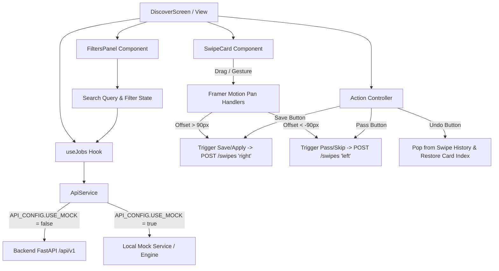

# SwipeX — Milestone 2: Day 1 Deliverables
## Frontend & User Experience (Intern 1)

---

### Table of Contents
1. [Executive Summary & Checkpoint Status](#1-executive-summary--checkpoint-status)
2. [API Contract & Schema Review (Intern 2 & 3 Dependencies)](#2-api-contract--schema-review-intern-2--3-dependencies)
3. [Swipe Gesture Library Evaluation & Decision](#3-swipe-gesture-library-evaluation--decision)
4. [UI/UX Wireframes & Component Specifications](#4-uiux-wireframes--component-specifications)
   - [4.1 Swipe Deck & Job Card](#41-swipe-deck--job-card)
   - [4.2 Filters & Search Panel](#42-filters--search-panel)
   - [4.3 Company & Startup Listing Pages](#43-company--startup-listing-pages)
5. [Component Architecture & State Machine](#5-component-architecture--state-machine)
6. [Change Control & Contract Alignment Flags](#6-change-control--contract-alignment-flags)
7. [Day 2 Readiness & Next Steps](#7-day-2-readiness--next-steps)

---

## 1. Executive Summary & Checkpoint Status

| Checkpoint | Target | Status | Notes |
|---|---|---|---|
| **API Contract Review** | Review `GET /jobs`, `POST /swipes`, schema notes | ✅ Completed | Validated against backend models (`swipe.py`, `jobs.py`, `swipes.py`). |
| **Wireframes Generated** | Swipe Deck, Job Card, Filters, Company Pages | ✅ Completed | ASCII wireframes & UX specs drafted with interaction rules. |
| **Swipe Library Selection** | `react-tinder-card` vs `Framer Motion` | ✅ Completed | Selected **Custom Framer Motion** (React 19 compatibility & physics control). |
| **Contract Freeze Readiness** | Align contracts with Intern 2 & 3 before Day 2 EOD | ✅ Completed | Flagged Day 4 `/companies` & freshness/competition fields for standup. |

---

## 2. API Contract & Schema Review (Intern 2 & 3 Dependencies)

### 2.1 `GET /api/v1/jobs` (Job Feed)
- **Endpoint:** `GET /api/v1/jobs?limit=20&offset=0`
- **Authentication:** Bearer JWT required (extracts `user_id` from `sub` claim).
- **Behavior:** Queries jobs table, dynamically filters out jobs previously swiped by the user (using Redis `swiped:{user_id}` set or DB fallback).
- **Backend Schema (`JobOut`):**
  ```typescript
  interface JobOut {
    job_id: string;
    title: string;
    company: string;
    location: string;
    salary_range?: string;
    work_environment?: 'Remote' | 'Hybrid' | 'On-site';
    industry?: string;
    // Enhanced fields for Milestone 2:
    company_logo?: string;
    banner_image?: string;
    skills?: string[];
    posted_at?: string;
    competition_level?: 'low' | 'medium' | 'high'; // < 10 applicants = low
    company_type?: 'MNC' | 'Startup' | 'Early-stage';
  }
  ```

### 2.2 `POST /api/v1/swipes` (Record Action)
- **Endpoint:** `POST /api/v1/swipes`
- **Request Body:**
  ```json
  {
    "job_id": "job_nexus_01",
    "direction": "right" // "right" = apply/save, "left" = skip/pass
  }
  ```
- **Response (201 Created):**
  ```json
  {
    "swipe_id": 1042
  }
  ```
- **Idempotency / Upsert Strategy:**
  - Unique constraint `(user_id_ref, job_id_ref)`.
  - Swiping on an already swiped job updates the existing record (`direction` + `swiped_at`), allowing user undo / change-of-mind without HTTP 409 collisions.

### 2.3 `GET /api/v1/swipes/history`
- **Response (200 OK):**
  ```json
  {
    "items": [
      {
        "job_id": "job_nexus_01",
        "direction": "right",
        "swiped_at": "2026-09-15T16:00:00Z"
      }
    ],
    "total": 1
  }
  ```

---

## 3. Swipe Gesture Library Evaluation & Decision

### Evaluation Matrix

| Criterion | `react-tinder-card` | Custom Framer Motion Drag |
|---|---|---|
| **React 19 Compatibility** | ⚠️ Issues with peer dependencies / ref forwarding in React 19 | ✅ Native React 19 support via `framer-motion` v13+ |
| **Visual Stamp Overlays** | Requires manual touch listeners for dynamic opacity | ✅ Fluid `useMotionValue` + `useTransform` (60fps GPU) |
| **Programmatic Controls** | Imperative ref triggering (`cardRef.current.swipe('left')`) | ✅ Direct state/animation control (`setExitX`) |
| **Card Stack Elevation & 3D Tilt** | Static rotation configuration | ✅ Dynamic tilt curve linked to drag offset (`rotate`, `scale`) |
| **Dependencies & Bundle** | Additional npm package | ✅ Zero additional dependencies (`framer-motion` already installed) |
| **Mobile & Touch Gestures** | Basic touch events | ✅ Native pointer, touch, and trackpad drag constraints |

### Decision
**Selected: Custom Framer Motion Drag Implementation**
- *Rationale:* Zero friction with React 19, hardware-accelerated animations, pixel-perfect dynamic `LIKE / PASS` badges that fade smoothly as the user drags, and built-in keyboard + button programmatic triggers.

---

## 4. UI/UX Wireframes & Component Specifications

### 4.1 Swipe Deck & Job Card Wireframe

```text
+-----------------------------------------------------------------------+
|  SWIPEX DISCOVERY FEED                               [Alex M. (Candidate)] |
+-----------------------------------------------------------------------+
|                                                                       |
|   +-------------------------- JOB CARD STACK -----------------------+ |
|   |  [ PASS (Left) ]                             [ SAVE / APPLY (Rt)]| |
|   |  +------------------------------------------------------------+ | |
|   |  | [ COMPANY BANNER / GRADIENT IMAGE ]                        | | |
|   |  | [Company Logo]                               [ HOT MATCH 🔥] | | |
|   |  +------------------------------------------------------------+ | |
|   |  |                                                            | | |
|   |  |  Senior Frontend Engineer                                  | | |
|   |  |  Nexus Tech  •  San Francisco, CA  •  Full-time            | | |
|   |  |                                                            | | |
|   |  |  💰 $140,000 - $175,000 / yr       📍 Remote (US-only)     | | |
|   |  |  🕒 Posted 2 days ago (Fresh)     ⚡ Low Competition (<10) | | |
|   |  |                                                            | | |
|   |  |  Tech Stack & Skills:                                      | | |
|   |  |  [ React ]  [ TypeScript ]  [ Tailwind ]  [ GraphQL ]       | | |
|   |  |                                                            | | |
|   |  |  Role Summary:                                             | | |
|   |  |  "Building next-generation real-time collaboration tools..."   | | |
|   |  |                                                            | | |
|   |  |  [ ℹ️ View Full Details ]                                   | | |
|   |  +------------------------------------------------------------+ | |
|   +-----------------------------------------------------------------+ |
|                                                                       |
|   +--------------------- ACTION CONTROLS --------------------------+ |
|   |      ( ↺ Undo )       ( ✕ Pass )       ( ❤️ Apply / Save )      | |
|   +-----------------------------------------------------------------+ |
|               [ Tip: Use Arrow Left / Arrow Right keys to swipe ]     |
+-----------------------------------------------------------------------+
```

### 4.2 Filters & Search Panel Wireframe

```text
+-----------------------------------------------------------------------+
| 🔍 SEARCH & FILTERS PANEL                                             |
+-----------------------------------------------------------------------+
|  [ 🔍 Search by job title, company, or keyword...                  ] |
|                                                                       |
|  COMPANY TYPE:                                                        |
|  [x] All Companies   [ ] MNCs (500+)   [ ] High-Growth   [ ] Seed/Early|
|                                                                       |
|  WORK ENVIRONMENT:                                                    |
|  [x] Remote          [x] Hybrid        [ ] On-site                    |
|                                                                       |
|  SALARY RANGE ($/yr):                                                 |
|  [$ 80k ] ══════════════════════════════════════════ [ $ 220k+ ]      |
|                                                                       |
|  ADVANCED FILTERS (Quick Chips):                                      |
|  [ ✨ Fresher-Friendly ]   [ ⚡ Low Competition ]   [ 🕒 Recently Posted]|
|                                                                       |
|  [ Reset Filters ]                                 [ Apply Filters ]  |
+-----------------------------------------------------------------------+
```

### 4.3 Company & Startup Listing Pages Wireframe

```text
+-----------------------------------------------------------------------+
| 🏢 EXPLORE COMPANIES & STARTUPS                      [ Search Co. 🔍 ] |
+-----------------------------------------------------------------------+
| Filter: [ All Types ▼ ]  [ Industry: Tech ▼ ]  [ Size: 50-200 ▼ ]     |
|                                                                       |
| +--------------------------------+  +--------------------------------+|
| | [Logo]  Stripe                 |  | [Logo]  Vercel                 ||
| | Fintech • MNC (1000+ emp)      |  | Cloud/DevTools • High-Growth   ||
| | HQ: San Francisco, CA          |  | HQ: San Francisco, CA          ||
| | 🌐 stripe.com                  |  | 🌐 vercel.com                  ||
| |                                |  |                                ||
| | 💼 14 Open Positions           |  | 💼 8 Open Positions            ||
| | [ View Open Jobs -> ]          |  | [ View Open Jobs -> ]          ||
| +--------------------------------+  +--------------------------------+|
|                                                                       |
| +--------------------------------+  +--------------------------------+|
| | [Logo]  Supabase               |  | [Logo]  Resend                 ||
| | Open Source DB • Series B      |  | Developer Email • Early-Stage  ||
| | HQ: Remote-First               |  | HQ: Remote                     ||
| | 🌐 supabase.com                |  | 🌐 resend.com                  ||
| |                                |  |                                ||
| | 💼 6 Open Positions            |  | 💼 3 Open Positions            ||
| | [ View Open Jobs -> ]          |  | [ View Open Jobs -> ]          ||
| +--------------------------------+  +--------------------------------+|
+-----------------------------------------------------------------------+
```

---

## 5. Component Architecture & State Machine



---

## 6. Change Control & Contract Alignment Flags

Per the Milestone 2 Change Control policy, the following items are flagged for team standup before Contract Freeze (Day 2 EOD):

1. **Company Directory Endpoint:**
   - *Requirement:* Day 4 needs a listing of companies/startups.
   - *Proposal:* Intern 2 provides `GET /api/v1/companies?type=&industry=&search=` returning company profile + active job counts.
2. **Freshness & Competition Metadata:**
   - *Requirement:* Frontend Job Card displays "Fresh" and "Low Competition" tags.
   - *Proposal:* `JobOut` in FastAPI should include `posted_at` (ISO timestamp) and `applicant_count` (int) so the UI can compute or receive pre-calculated badges without breaking schema.
3. **Undo Swipe Endpoint vs Client State:**
   - *Proposal:* Frontend will handle undo optimistically by rolling back local index and issuing an upsert update if necessary.

---

## 7. Day 2 Readiness & Next Steps

With Day 1 checkpoints finalized:
- **Wireframes:** Finalized & documented.
- **Swipe Engine:** Selected Framer Motion drag architecture.
- **Contracts:** Verified against backend routers and schemas.
- **Ready for Day 2 Execution:**
  - Build reusable Job Card component with logo, title, company, salary, freshness, and competition tags.
  - Implement swipe gesture interactions against mock data (`right` = apply, `left` = skip).
  - Scaffold Filters panel UI (MNC/Startup/Remote/Salary/Experience controls).
