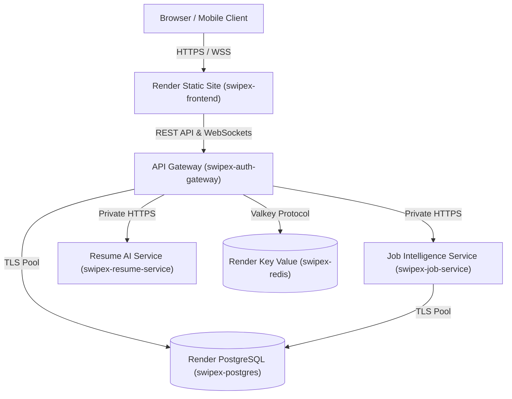

# SwipeX — Render Cloud Deployment Runbook & Free Tier Architecture
**Project:** SwipeX — AI-Powered Swipe-Based Job Discovery & Career Intelligence Platform  
**Owner:** Intern 5 (Omkar — Platform, Testing, CI/CD & Deployment)  
**Branch:** `Team-4`  
**Date of Audit & Verification:** October 10, 2026  
**Infrastructure-as-Code Spec:** [`render.yaml`](file:///d:/Webapp/Working_webapps/SwipeX_infosys_springboard_Project/AI-Powered-Swipe-Based-Job-Discovery-and-Personalized-Career-Intelligence-Platform/render.yaml)

---

## 1. Verified Render Free Tier Limits & Constraints (October 2026)

Based on official Render documentation and pricing audits conducted on October 10, 2026:

| Resource Type | Free Tier Allocation | Expiration & Limitations | Architectural Mitigation in SwipeX |
|---|---|---|---|
| **Web Services (Python / ASGI)** | 512 MB RAM, 0.1 CPU, 750 free instance-hours/month shared | Spins down to sleep after **15 minutes of inactivity**. Cold start takes **50s – 120s** to boot. | `smoke_test.py` includes a cold-start polling loop with 120s timeout and warm-up pings. |
| **PostgreSQL Database** | 1 GB SSD storage, 256 MB RAM | **Expires 30 days after creation**. 14-day grace period to upgrade or export. No connection pooling or automated backups included. | Idempotent schema + seed script (`migrate_and_seed.py`) can re-initialize a replacement database in seconds on restart. |
| **Key Value (Redis / Valkey)** | 25 MB RAM, 50 maximum concurrent connections | **No disk persistence** (in-memory only). Data evicted if memory ceiling reached. | Used strictly for ephemeral JWT blocklist, rate limiting, and temporary cache. No business data stored in Redis. |
| **Static Site (Frontend)** | Unlimited builds, Global CDN, 100 GB bandwidth/month | SPA routing rewrite (`/*` -> `/index.html`) required. | Configured via `routes` in `render.yaml` with security headers (`X-Frame-Options: DENY`, `nosniff`). |
| **Persistent Disks & Private Services** | Paid plans only (disks starting at $0.25/GB/mo; private services require paid team plans) | Not available on Render Free Tier. | MinIO & ChromaDB fallback to in-process SQLite / ephemeral disk for local demo, or cloud S3/Chroma when credentials provided. |
| **Pre-Deploy Commands (`preDeployCommand`)** | Paid plans only | Not supported on Free Web Services. | Replaced by `entrypoint_render.py`, which normalizes DB URLs and executes `migrate_and_seed.py` on container boot. |

---

## 2. Infrastructure as Code Architecture (`render.yaml`)

SwipeX defines its complete multi-tier cloud infrastructure using Render Blueprints:



### Component Breakdown:
1. **`swipex-frontend`** (`runtime: static`):
   - Path: `frontend_boomika`
   - Build: `npm ci && npm run build`
   - Publish: `dist`
   - Injected Env: `VITE_BASE_API_URL`, `VITE_WS_URL`, `VITE_USE_MOCK=false`
2. **`swipex-auth-gateway`** (`runtime: python`):
   - Path: Root
   - Start Command: `python integration_omkar/deploy/entrypoint_render.py --app backend_mansi.app.main:app`
   - Binds to: `0.0.0.0:$PORT`
   - Auto-generated Secrets: `JWT_SECRET_KEY`, `SESSION_SECRET_KEY`, `GATEWAY_SHARED_SECRET`
3. **`swipex-job-service`** (`runtime: python`):
   - Path: Root
   - Start Command: `python integration_omkar/deploy/entrypoint_render.py --app data_hanith.main:app`
4. **`swipex-resume-service`** (`runtime: python`):
   - Path: Root
   - Start Command: `python integration_omkar/deploy/entrypoint_render.py --app aiml_hemalatha.app.main:app`
5. **`swipex-postgres`** (`databaseName: swipex_auth`, `plan: free`):
   - Referenced dynamically via `fromDatabase: connectionString`.
6. **`swipex-redis`** (`type: keyvalue`, `plan: free`):
   - Referenced dynamically via `fromService: connectionString`.

---

## 3. Environment Variable & Secrets Mapping Matrix

| Variable Name | Target Service | Provisioning Mechanism | Production Location |
|---|---|---|---|
| `DATABASE_URL` | Gateway, Job Service | Render Blueprint (`fromDatabase: connectionString`) | Render Internal PostgreSQL Connection |
| `REDIS_URL` | Gateway | Render Blueprint (`fromService: connectionString`) | Render Internal Valkey Connection |
| `PORT` | All Web Services | Injected automatically by Render | Render Runtime Environment |
| `JWT_SECRET_KEY` | Gateway | Render Blueprint (`generateValue: true`) | Render Service Environment |
| `SESSION_SECRET_KEY` | Gateway | Render Blueprint (`generateValue: true`) | Render Service Environment |
| `GATEWAY_SHARED_SECRET` | Gateway, Job Service | Blueprint (`generateValue: true` + `fromService`) | Shared Internal Token |
| `CORS_ORIGINS` | Gateway | Blueprint static value (`https://swipex-frontend.onrender.com`) | Render Service Environment |
| `JOB_SERVICE_URL` | Gateway, Resume Service | Blueprint static value (`https://swipex-job-service.onrender.com`) | Render Internal / Public DNS |
| `RESUME_SERVICE_URL` | Gateway | Blueprint static value (`https://swipex-resume-service.onrender.com`) | Render Internal / Public DNS |
| `MATCHING_ENGINE_URL`| Gateway | Blueprint static value (`https://swipex-resume-service.onrender.com`) | Render Internal / Public DNS |
| `RUN_MIGRATION` | Gateway | Blueprint static value (`true`) | Render Service Environment |
| `RENDER_DEPLOY_HOOK_*`| CI Deploy Stage | GitHub Secrets | GitHub Repo Settings -> Secrets |
| `RENDER_BASE_URL` | CI Smoke Test Stage | GitHub Repository Variable | GitHub Repo Settings -> Variables |

---

## 4. Step-by-Step Render Deployment Guide

### Step 1: Create Blueprint in Render Dashboard
1. Log in to [Render Dashboard](https://dashboard.render.com).
2. Click **New +** -> **Blueprint**.
3. Connect repository `springboardmentor54321v/AI-Powered-Swipe-Based-Job-Discovery-and-Personalized-Career-Intelligence-Platform`.
4. Select branch `Team-4` (or `main` upon release).
5. Render will automatically parse `render.yaml` and display all 6 components (`swipex-postgres`, `swipex-redis`, `swipex-frontend`, `swipex-auth-gateway`, `swipex-job-service`, `swipex-resume-service`).
6. Click **Apply**.

### Step 2: Configure Deploy Hooks for CI Continuous Deployment
1. For each web service in the Render Dashboard:
   - Go to **Settings** -> **Deploy Hook**.
   - Copy the unique Webhook URL (`https://api.render.com/deploy/srv-xxxx?key=yyyy`).
2. In GitHub Repository:
   - Navigate to **Settings** -> **Secrets and variables** -> **Actions**.
   - Add the following Secrets:
     - `RENDER_DEPLOY_HOOK_GATEWAY`
     - `RENDER_DEPLOY_HOOK_JOB`
     - `RENDER_DEPLOY_HOOK_RESUME`
     - `RENDER_DEPLOY_HOOK_FRONTEND`
   - Add Repository Variable:
     - `RENDER_BASE_URL`: `https://swipex-auth-gateway.onrender.com`

### Step 3: Verify Deployment & Cold Starts
Run the automated post-deploy smoke test:
```bash
python integration_omkar/scripts/smoke_test.py --base-url https://swipex-auth-gateway.onrender.com --timeout 180
```

---

## 5. Rollback Runbook (Zero-Downtime Recovery)

If a deployment fails smoke tests or introduces regressions:

### Method 1: Instant Dashboard Rollback (Recommended)
1. Go to Render Dashboard -> Select failed service (e.g. `swipex-auth-gateway`).
2. Click the **Events** or **Deploys** tab.
3. Locate the previous healthy deployment (labeled with previous Git commit SHA).
4. Click the three dots `...` on that deploy -> Select **Rollback to this deploy**.
5. Render immediately switches traffic back to the previous immutable build container in < 15 seconds.

### Method 2: Git Rollback
```bash
git checkout main
git revert HEAD --no-edit
git push origin main
```
This triggers the CI pipeline, which validates the reverted code and triggers the Render Deploy Hooks.

---

## 6. Recommended GitHub Branch Protection Settings

To ensure zero regressions land on production:
1. Target branch: `main` and `Team-4`.
2. Require pull request before merging: **Yes** (1 approval).
3. Require status checks to pass before merging:
   - `Lint & Code Style Gate`
   - `Frontend Vitest & Production Build`
   - `Unit Test Suite (backend)`
   - `Unit Test Suite (aiml)`
   - `Unit Test Suite (m3-schema)`
   - `Unit Test Suite (m4)`
   - `Unit Test Suite (integration-unit)`
   - `Render Blueprint & Compose Validation`
   - `Live Docker Stack E2E, RBAC & Contracts`
   - `CI Pipeline Quality & Gate Summary`
4. Require linear history: **Yes**.
